27 ноября я опубликовал одиннадцатую заметку этой серии — челленджа, который придумал Рамайя Траск: сто дней, сто бизнесов, сто сайтов. День первый — семейная строительная компания с Марина-Альты. [Эта страница здесь.](https://wellyington.github.io/journal/ru/articles/sait-do-slova-da/) День второй — театр в Малаге. [Она здесь.](https://wellyington.github.io/journal/ru/articles/mesto-dlya-tselogo-sezona/) День третий — семейный ресторан в Эстепоне. [Она здесь.](https://wellyington.github.io/journal/ru/articles/mesto-za-dlinnym-stolom/) День четвёртый — частная консалтинговая компания по недвижимости в Малаге. [Она здесь.](https://wellyington.github.io/journal/ru/articles/suzhdenie-vazhnee-obema/) День пятый — ресторан дегустационных меню в Мотриле. [Она здесь.](https://wellyington.github.io/journal/ru/articles/tak-zhe-tshchatelno-kak-na-kukhne/) День шестой — заведение с курицей-гриль в Эстепоне. [Она здесь.](https://wellyington.github.io/journal/ru/articles/ot-prilavka-do-cheka/) День седьмой — семейный отель в Кавосе на Корфу. [Она здесь.](https://wellyington.github.io/journal/ru/articles/tot-zhe-bassein-nochyu/) День восьмой — три дома в историческом центре Малаги. [Она здесь.](https://wellyington.github.io/journal/ru/articles/tri-doma-odna-dver/) День девятый — модельное агентство из Марбельи и Лондона. [Она здесь.](https://wellyington.github.io/journal/ru/articles/pust-govoryat-fotografii/) День десятый — студия пилатеса в Марбелье. [Она здесь.](https://wellyington.github.io/journal/ru/articles/kachestvo-vazhnee-mody/)

Сегодня — виртуальный ассистент. Elevate Admin Studio — бизнес Шарлотты, она работает из Лидса с клиентами по всей Великобритании. За плечами у неё больше 22 лет на старших должностях в административной и проектной поддержке, из них пять — в NHS, британской государственной системе здравоохранения, на национальном уровне. Теперь этот опыт достаётся коучам, консультантам, людям творческих профессий, малому бизнесу и растущим командам, которым нужна помощь за кулисами, но которые не готовы брать человека в штат. Работа охватывает администрирование, почту и календарь, соцсети, финансовую рутину, мероприятия, проекты, документы и данные. Её нынешний сайт — [elevateadminstudio.co.uk](https://elevateadminstudio.co.uk/).

Концепция здесь: [Elevate Admin Studio, день одиннадцатый](https://wellyington.github.io/challenge/day11/).

## сайт — это первая работа

Виртуальный ассистент продаёт то, что трудно показать: порядок. Снаружи не видно ни аккуратного почтового ящика, ни календаря без накладок, ни письма-напоминания, ушедшего вовремя. Зато будущий клиент видит сайт — ещё до того, как с ней поговорит. И читает его, осознанно или нет, как образец работы.

Отсюда и задача. Если на сайте беспорядок, посетитель думает, не будет ли беспорядка и в делах. Если цены спрятаны за «свяжитесь с нами для расчёта», он гадает, что ещё окажется размытым. Если непонятен следующий шаг, он сомневается, насколько понятными будут еженедельные отчёты. Сайт ассистента должен быть противоположностью всего этого: аккуратным, честным в вопросе денег и ясным в том, что будет дальше.

Поэтому направление — спокойный, упорядоченный одностраничный сайт. Палитра из тёмно-синего, кремового и золотого, классические прописные буквы для заголовков, лёгкий гротеск для текста, тонкие линии, делящие страницу на понятные разделы, и всё, что нужно клиенту, — в одной прокрутке и в том порядке, в каком это нужно.

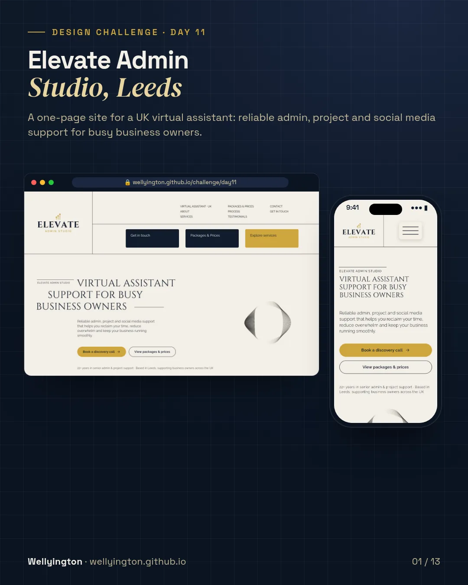
*День одиннадцатый: одностраничный сайт британского виртуального ассистента — административная, проектная поддержка и соцсети.*

## поддержка для занятых предпринимателей

Страница открывается коротким экраном загрузки. Счётчик доходит до ста, пока сменяются четыре слова: organising, scheduling, delegating, ready — организовать, спланировать, делегировать, готово. Потом появляется кнопка Enter site. Это маленький театральный жест, и он сообщает, чем занимается сервис, раньше, чем прочитана хоть одна фраза.

За ним — первый экран. Слева заголовок высокими разреженными прописными: virtual assistant support for busy business owners — поддержка виртуального ассистента для занятых предпринимателей. Под ним одна фраза: надёжная административная, проектная и SMM-поддержка, которая помогает вернуть время, снять перегрузку и сохранить бизнес в спокойном рабочем ритме. Затем две кнопки: золотая — записаться на знакомственный звонок, контурная — посмотреть пакеты и цены. Справа — короткое зацикленное видео: фигура из тонких линий медленно поворачивается.

А внизу — тихая строка, которая делает очень много: 22+ года в старшей административной и проектной поддержке, база в Лидсе, клиенты по всей Великобритании. Опыт, место и охват — ещё до первой прокрутки.

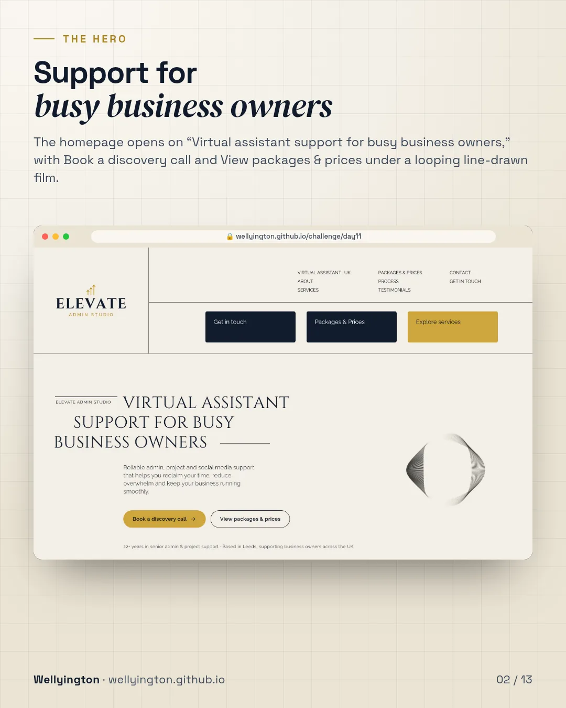
*Первый экран: один заголовок, две кнопки, видео из линий и строка о 22 годах опыта.*

## шапка, устроенная как картотека

Шапка устроена как оглавление. Логотип стоит в отдельной панели слева. Справа разделы перечислены в три маленьких столбца — так подписывают ящики картотеки: виртуальный ассистент, обо мне, услуги; пакеты и цены, процесс, отзывы; контакты и написать. Ниже — три блока-ярлыка: Get in touch и Packages & Prices тёмно-синие, Explore services — золотой.

На телефоне и на любом экране уже 1025 пикселей шапка сводится к логотипу и кнопке с тремя полосками. Нажмёшь — тёмно-синяя панель за 0,8 секунды выезжает на весь экран, и семь разделов выстраиваются в один столбец, каждый на своей линии: Home, About, Services, Packages & Prices, Process, Testimonials, Contact. Строки достаточно крупные, чтобы попадать не целясь, а крестик для закрытия появляется там, где была кнопка.

На одностраничном сайте меню — это, по сути, оглавление. Пусть и читается как оглавление.

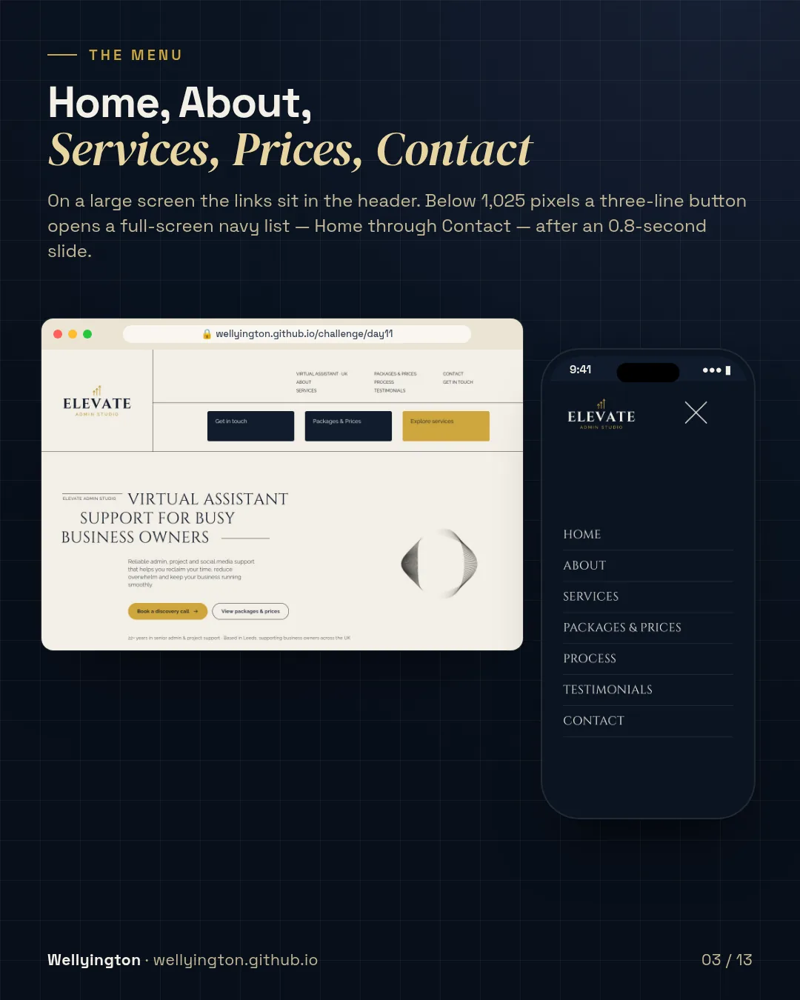
*На большом экране ссылки в шапке, на телефоне — полноэкранный тёмно-синий список.*

## привет, я Шарлотта

В бизнесе одного человека этот человек и есть продукт. Поэтому первый раздел после первого экрана знакомит с ней, её собственным голосом: привет, я Шарлотта, основательница Elevate. Рядом — портрет.

Текст короткий и конкретный. Она даёт спокойную, организованную и надёжную виртуальную поддержку занятым предпринимателям, которым нужна помощь за кулисами. Работает с теми, кто тащит на себе слишком много и кому нужна надёжная опора, чтобы всё было в порядке. Администрирование, соцсети, координация проектов или повседневная организация — она помогает внести больше спокойствия, ясности и структуры. Некоторые фразы набраны более плотным начертанием, чтобы беглый взгляд выхватил обещание, не читая каждое слово.

Ниже — список тех, с кем она работает: коучи и консультанты, творческие специалисты и поставщики услуг, владельцы малого бизнеса, растущие команды и предприниматели, готовые делегировать. И вопрос: готовы спокойно передать рутину? Этот список важнее, чем кажется. Кто узнаёт в нём себя, перестаёт гадать, подходит ли ему это.

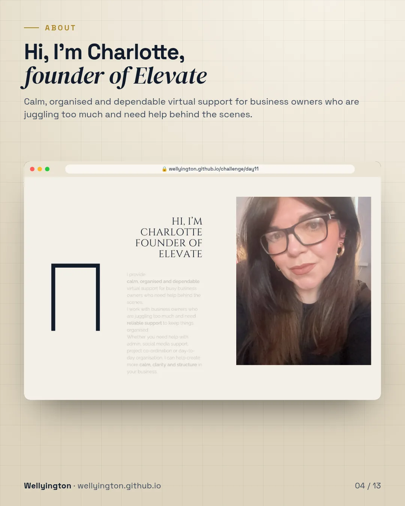
*Привет, я Шарлотта: короткое представление её словами рядом с портретом.*

## два десятилетия — в цифрах и в ценностях

Следующий раздел, meet Charlotte — знакомьтесь, Шарлотта, — про опыт. Больше двух десятилетий спокойной и умелой поддержки. Два абзаца объясняют, откуда он: старшие административные и проектные должности, пять лет в NHS на национальном уровне, поддержка команд, руководителей и программ — расстановка приоритетов, организация встреч, подготовка документов, контроль поручений. А затем — сегодня: этот опыт для предпринимателей, которым нужна надёжная поддержка без обязательств найма в штат.

Под текстом три цифры, которые отсчитываются вверх, когда появляются на экране: 22+ года в старшей административной и проектной поддержке, 5 лет в NHS на национальном уровне и Лидс — база, клиенты по всей стране. Справа тёмно-синяя карточка рассказывает, каково с ней работать и чего ждать клиенту: ясной коммуникации, надёжного выполнения обещанного, упорядоченных систем, спокойного профессионального подхода, поддержки, которая ощущается как часть вашего бизнеса, а также бережности, деликатности и внимания к деталям.

Ниже — пять карточек ценностей, у каждой маленькая золотая иконка и несколько строк: надёжность, забота и профессионализм, организованность и ясность, доверие и конфиденциальность, партнёрство. Разделы с ценностями часто бывают для галочки. Здесь они на своём месте: для ассистента, который увидит вашу почту, счета и данные ваших клиентов, доверие и конфиденциальность — не абстракции. Это вопрос, который каждый клиент молча задаёт себе.

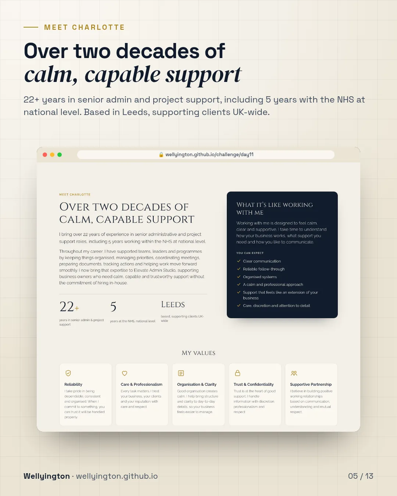
*22 года, 5 из них в NHS, база в Лидсе и пять ценностей, которые отвечают на вопрос о доверии.*

## шесть услуг, открыта одна

Раздел услуг становится тёмным. Он начинается с фотографии ежемесячного планера и ручек и короткого вступления: гибкая поддержка, чтобы вы чувствовали себя организованнее, меньше перегружены и лучше контролировали свою нагрузку — постоянно или по отдельным задачам.

Дальше шесть услуг в аккордеоне, где открыта только одна: Social Media Admin Support, Finance Admin Support, Event Admin Support, Project Support, Traditional PA/EA Support и Documents & Data Support. Каждая, раскрываясь, следует одной схеме: описание в одну строку, задачи в виде маленьких контурных меток, для кого это подходит и ссылка, чтобы спросить именно об этой услуге.

Соцсети открыты с самого начала. Метки — отслеживание комментариев, работа с входящими сообщениями, ответы по вашим инструкциям, помощь с контентом, шаблоны и графика в Canva, оформление подписей, планирование публикаций и еженедельные отчёты. Финансовый блок — выставление счетов, напоминания о неоплаченных, работа с коммерческими предложениями, учёт расходов и обновление таблиц, и там прямо сказано: это поддержка вашей финансовой рутины, но не замена бухгалтеру. Одна такая строка рождает доверие и избавляет всех от неловкого разговора потом.

Аккордеон не даёт длинному списку услуг превратиться в стену. Посетитель открывает то, за чем пришёл, читает и закрывает. А каждая ссылка «спросить» открывает письмо, где название услуги уже стоит в теме, так что Шарлотта понимает, о чём речь, ещё не открыв его.

В конце раздела — строка для сомневающихся: не знаете, какая помощь нужна? Это совершенно нормально. Можно вместе разобрать вашу текущую нагрузку. И кнопка записи на знакомственный звонок.

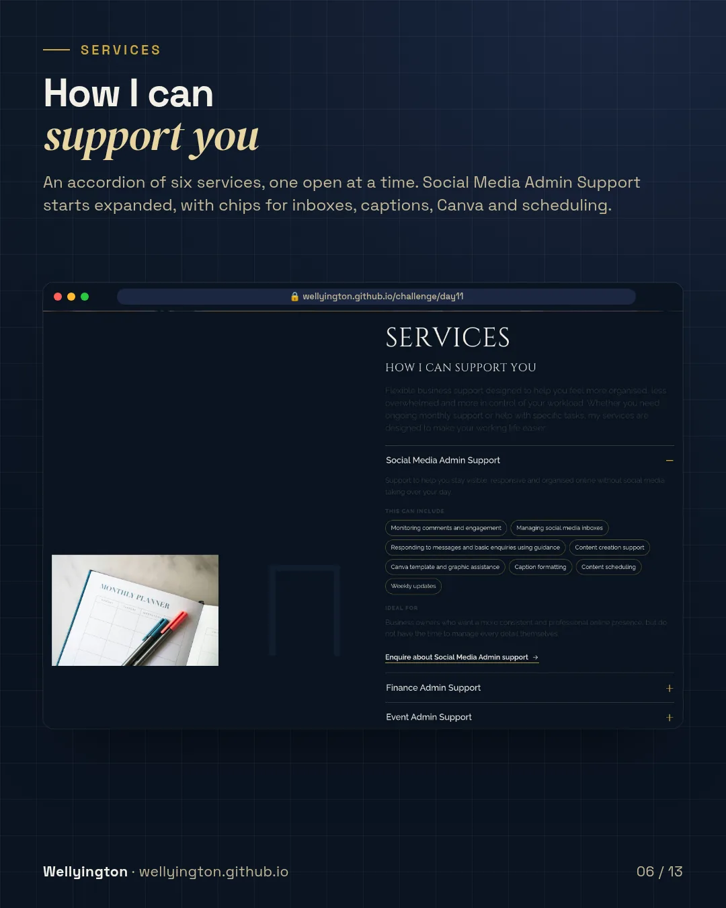
*Шесть услуг в аккордеоне. Соцсети открыты первыми, задачи — метками.*

## что происходит, когда вы пишете

Одна из негласных причин, по которым люди откладывают поиск помощи, — неизвестность. Будут ли давить продажами? Длинная анкета? Договор на первом же звонке? Раздел how it works — как это работает — снимает тревогу шестью шагами на вертикальной линии с пронумерованными кружками.

Шаг первый — написать по почте или в соцсетях, коротко о бизнесе. Точно знать, какая помощь нужна, на этом этапе не обязательно. Шаг второй — знакомственный звонок: короткий и неформальный, без давления и без обязательств. Маленькая ссылка раскрывает список тем, от текущих приоритетов до того, какой пакет может подойти. Шаг третий — предложение, которое приходит после звонка, со временем на раздумья. Шаг четвёртый — форма бронирования, договор и счёт, чтобы всё было согласовано до начала работы. Шаг пятый — подключение: доступы к системам, общие папки, доска Trello или трекер задач, предпочтения по связи и инструкции по тону общения. Шаг шестой — поддержка начинается, с ясной коммуникацией и регулярными отчётами.

Шесть шагов звучат как много. Но поданные так, они читаются наоборот: как работа человека, который делал это не раз и у которого есть система. Ровно за это клиент и платит.

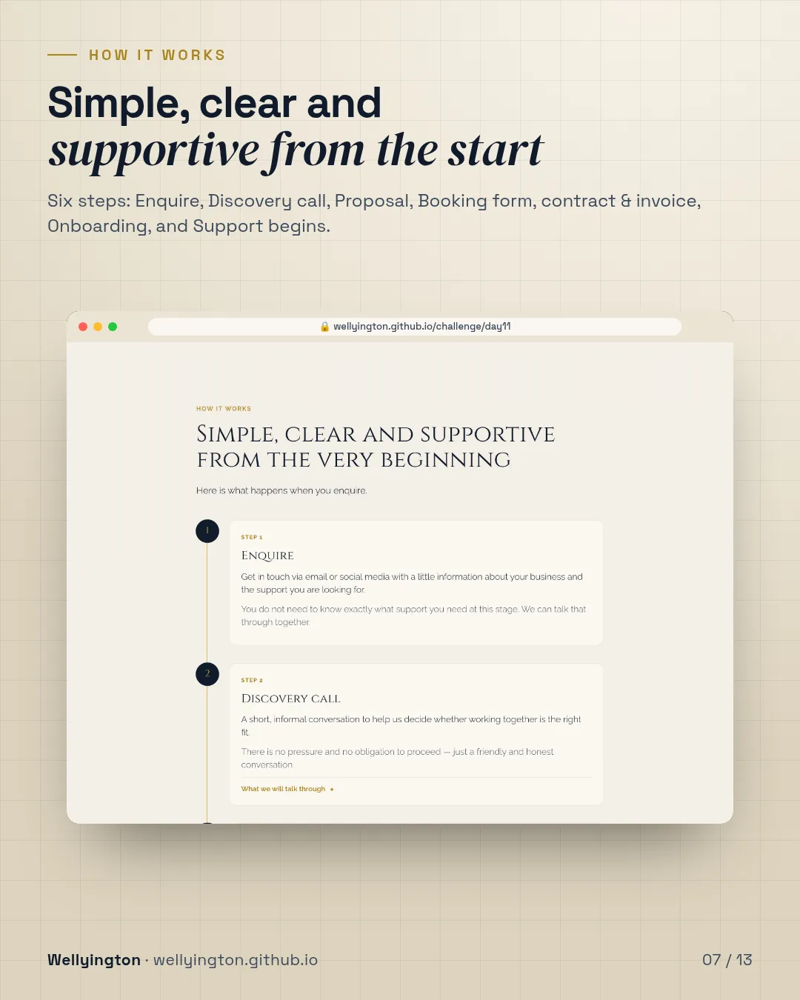
*Шесть шагов от первого письма до начала поддержки, каждый на пронумерованной линии.*

## цены вслух

Эту часть мне особенно хотелось сделать правильно. Многие сервисные бизнесы прячут цены, считая, что звонок продаёт лучше цифры. Для виртуального ассистента, по-моему, всё наоборот. Её клиенты заняты по определению. Посетитель, который видит цену, за минуту решает, записываться ли на звонок. Тот, кто её не видит, должен тратить время, чтобы выяснить, а занятые люди часто этого не делают.

Раздел начинается с аргумента в пользу виртуального ассистента в одной фразе: надёжная профессиональная поддержка без дополнительных расходов на сотрудника — отпускных, налогов, страховых взносов, пенсионных отчислений, офиса, техники или обучения. Затем три вкладки: ежемесячные пакеты часов, готовые пакеты и разовая работа или проекты.

Вкладка с ежемесячными пакетами — интерактивная. Вместо шести карточек рядом — ползунок: сколько часов поддержки в месяц? Он идёт от 12 до 60 часов в шесть шагов. Сдвиньте его — и карточка рядом меняется: The Assistant, 12 часов, £420 в месяц; The Coordinator, 20 часов, £700; The Senior Support, 30 часов, £1050; The Operations Partner, 40 часов, £1400; The Executive Support, 50 часов, £1750; The Strategic Support, 60 часов, £2100. У каждого — строка о том, кому он подходит, и кнопка запроса, которая открывает письмо с названием пакета уже в теме. По умолчанию выбран The Coordinator.

Ползунок делает то, чего не сделает таблица. Он позволяет начать со своего вопроса — сколько помощи мне нужно — и увидеть ответ, а не читать шесть вариантов и идти от обратного. Под ним прописаны условия: время учитывается с округлением до 15 минут, неиспользованные часы не переносятся на следующий месяц, в часы входит время на постановку задач и переписку, рекомендуется обязательство на три месяца, а свободных мест немного. Обычно такие условия всплывают только в договоре. Здесь они видны до первого письма.

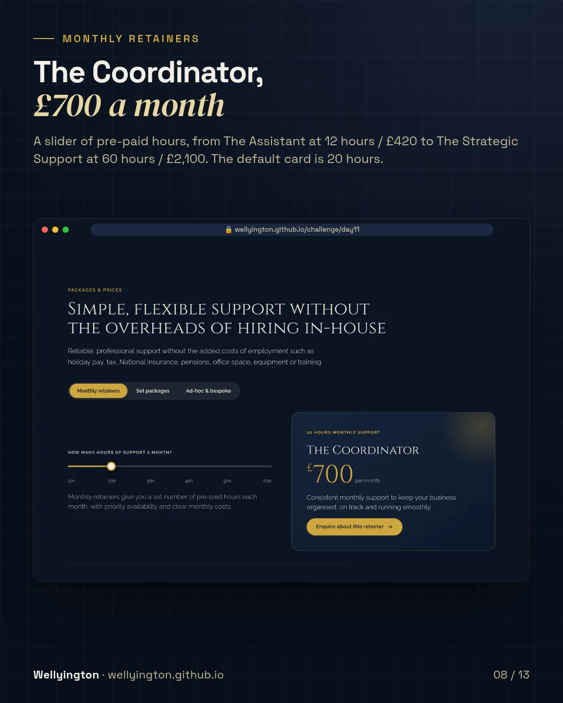
*Сдвигайте от 12 до 60 часов — карточка меняется. На 20 часах: The Coordinator, £700 в месяц.*

## пакеты, часы и проекты

Вторая вкладка — для тех, кому нужна помощь в чём-то одном. Три готовых пакета, у каждого своя карточка: Elevate Social Support за £450 в месяц — 10 единиц контента на одной-двух платформах; Executive Support & Project Coordination за £700 в месяц — почта и календарь плюс встречи, повестки, протоколы и контроль поручений; Elevate Inbox Management за £450 в месяц — от сортировки и выделения приоритетов до черновиков ответов на согласование и еженедельной сводки по почте. На каждой карточке есть ссылка what's included, раскрывающая полный список, и своя ссылка для запроса.

Третья вкладка — для всего остального. Ad-Hoc Support — £35 в час, минимальный заказ пять часов: разовые задачи, документы, таблицы, разбор завалов в почте, короткие проекты. Bespoke Project Support — цена по запросу, для работы, которая не укладывается в почасовой или ежемесячный формат; стоимость зависит от объёма проекта, сроков и согласованного брифа.

Под вкладками — одна фраза: не уверены, какой вариант ваш? Обсудим на знакомственном звонке и найдём подходящий. Цены дают точку отсчёта. Решение по-прежнему принимается на звонке.

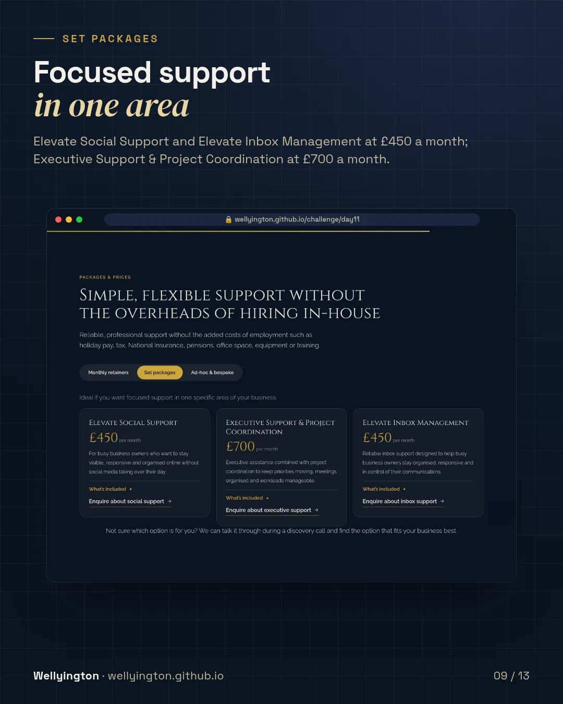
*Три готовых пакета для поддержки в одной области.*

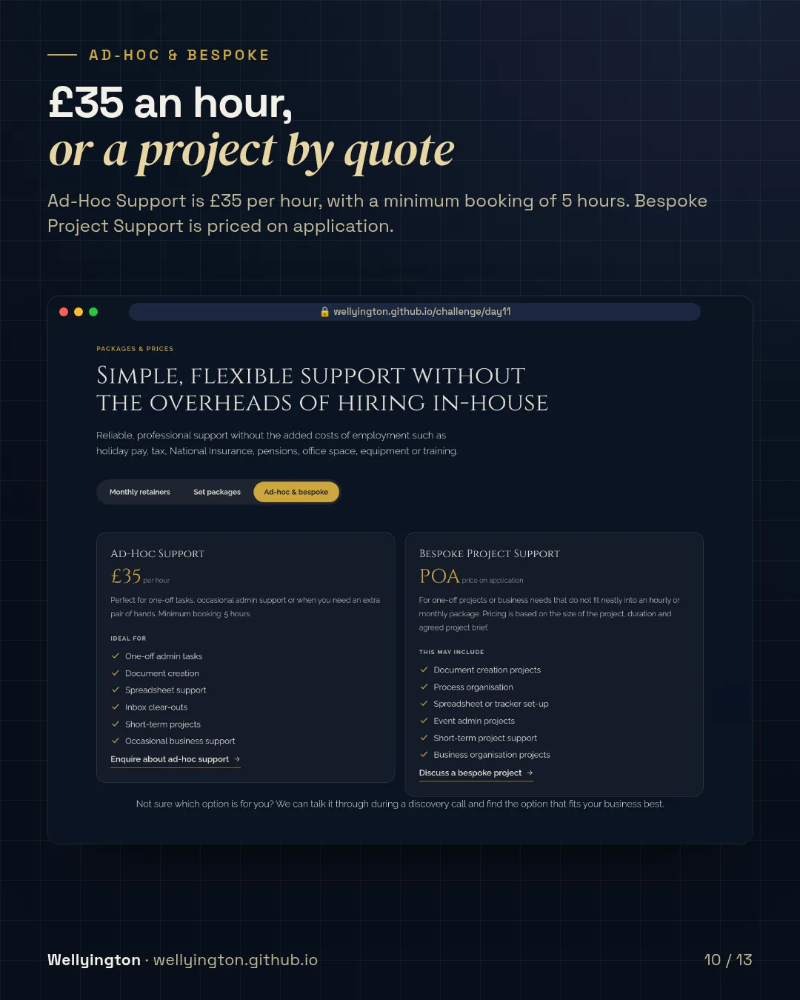
*£35 в час за разовые задачи или проект по индивидуальному расчёту.*

## поддержка, на которую можно опереться

Раздел отзывов короткий, и так и должно быть. Две цитаты в одной карточке со стрелками для переключения — от двух людей на высоких должностях, которые несколько лет работали с Шарлоттой.

Элли Гордон, бывшая старшая медсестра по направлению психического здоровья и нарушений интеллектуального развития в NHS England, называет её «тёплой, отзывчивой и гибкой». Дэвид Харлинг, BEM, национальный заместитель директора по сестринскому делу в области нарушений интеллектуального развития, пишет о национальных проектах, сжатых сроках и письменных отчётах высокого уровня.

На некоторых сайтах два отзыва выглядели бы бедно. Здесь они весомы — благодаря тому, кто их написал, и тому, что они описывают: годы работы, названные должности, конкретные дела. Лучше два настоящих конкретных отзыва с полными именами, чем десять анонимных.

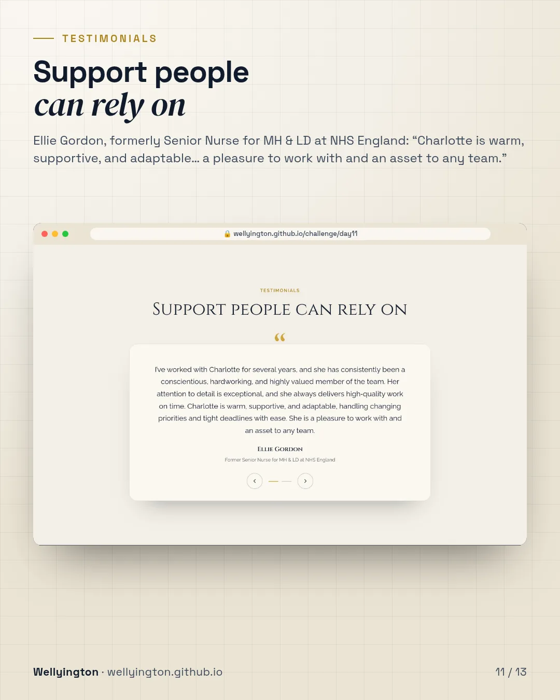
*Два именных отзыва от старших коллег, по одному за раз.*

## один адрес, две кнопки

Страница заканчивается там, куда указывал каждый раздел. Get in touch: давайте облегчим вашу нагрузку. Короткий абзац приглашает рассказать немного о бизнесе и нужной помощи и обещает ответ со следующими шагами.

Формы нет. Есть две кнопки: Email Charlotte, которая открывает новое письмо, уже адресованное ей, и Copy email address, которая копирует адрес и показывает маленькое подтверждение — для тех, кто пользуется почтой в браузере или предпочитает писать с другого устройства. Сам адрес напечатан ниже обычным текстом: charlotte@elevateadminstudio.co.uk.

Для бизнеса, построенного на человеке, который умеет хорошо отвечать на письма, это показалось правильным. Форма добавляет шаг и прослойку между клиентом и ней. Письмо идёт прямо в почтовый ящик, которым она профессионально управляет.

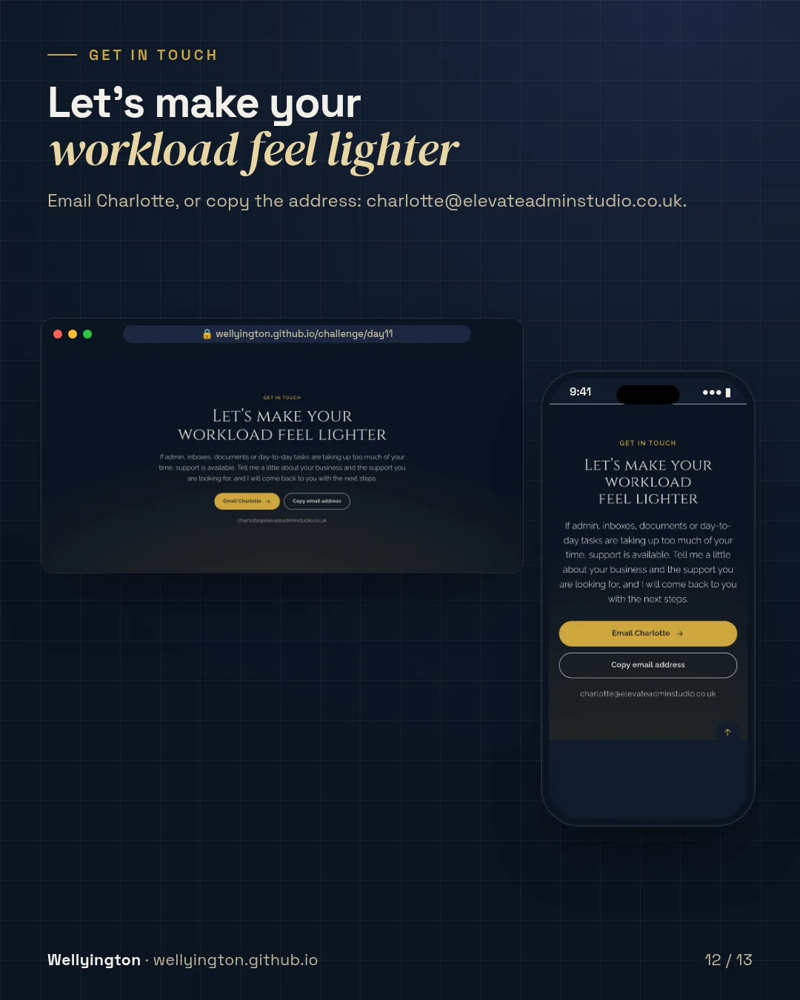
*Напишите Шарлотте или скопируйте адрес. Без формы посередине.*

## детали

В палитре три цвета: глубокий тёмно-синий, тёплый кремовый и приглушённое золото. Тёмно-синий несёт серьёзные части — меню, услуги и цены. Кремовый — личные: знакомство, ценности и отзывы. Золото оставлено для того, на что нажимают: главные кнопки, активная вкладка, ползунок.

Заголовки набраны Cinzel — классическими прописными, похожими на высеченную надпись; они дают маленькому бизнесу спокойное ощущение основательности. Основной текст — Raleway, лёгкий и открытый. Оба шрифта загружаются с самого сайта, а не из Google, так что, открывая страницу, никто не передаёт свой адрес третьей стороне.

Движение мягкое. Разделы проявляются и поднимаются на место при прокрутке, элементы — один чуть позже другого, а сама прокрутка сглажена. Для тех, кто попросил своё устройство уменьшить анимацию, эффекты появления отключаются и содержимое просто на месте. Весь сайт только на английском, потому что её клиенты в Великобритании.

## что это за концепция и что дальше

Факты в концепции — от Elevate Admin Studio: услуги и что в них входит, процесс, пакеты часов, готовые пакеты и ставки, опыт Шарлотты и два отзыва.

Новое — это структура: одна упорядоченная страница, меню, которое читается как оглавление, услуги в аккордеоне со ссылками-запросами, где названа услуга, процесс, расписанный по шагам, и цены, которые можно исследовать ползунком, а не выспрашивать.

Цифр по обращениям у меня нет, и выдумывать их я не буду. Чтобы превратить концепцию в работающий сайт, нужны практические шаги: условия использования, политика конфиденциальности и политика cookie, на которые ссылается подвал, написанные по британским правилам; ссылки на соцсети, о которых говорит первый шаг процесса и которых на странице пока нет; и возможность для Шарлотты самой обновлять цены, когда они меняются, чтобы страница никогда не показывала прошлогоднюю ставку.

## одиннадцать готово

У сайта виртуального ассистента одна главная задача: стать первым доказательством её организованности. Лучший способ — не написать «организованная» в заголовке, а быть такой: сказать, для кого это, что входит, сколько стоит, что будет дальше, и поставить каждую из этих вещей на своё ясное место.

Если вы продаёте услугу, а не товар, всё то же самое. Покажите человека, который за ней стоит. Скажите, что входит, а что нет. Поставьте цену на страницу, пусть даже стартовую. Объясните шаги от первого сообщения до первой работы. И сделайте способ связаться самым простым на странице.

Я веб-дизайнер из Эстепоны на Коста-дель-Соль, проектирую и делаю сайты для бизнеса в Испании и за её пределами. Если это похоже на ваш бизнес, напишите мне через [основной сайт](https://wellyington.github.io/ru/). Расскажите, чем вы занимаетесь и где, и я отвечу понятным языком. Концепция [здесь](https://wellyington.github.io/challenge/day11/), а нынешний сайт Elevate Admin Studio — [здесь](https://elevateadminstudio.co.uk/), чтобы вы могли сравнить. Одиннадцать готово, осталось восемьдесят девять.
